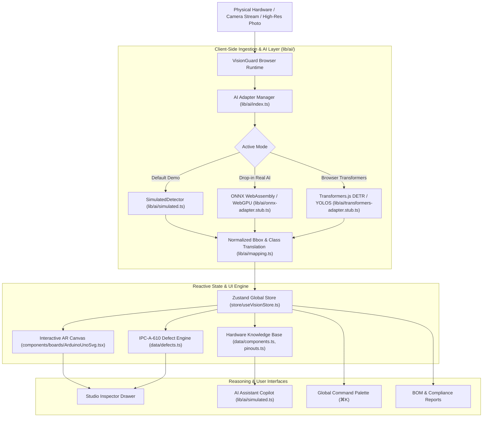

# VisionGuard – AI & AR-Powered Hardware Inspection and Diagnostics

[](https://opensource.org/licenses/MIT)
[](https://nextjs.org/)
[](https://www.typescriptlang.org/)
[](https://tailwindcss.com/)
[](https://github.com/pmndrs/zustand)
[](https://github.com)

> **Hackathon Track:** *Computer Vision, Edge AI & Hardware Security*  
> **Team:** *Access Denied*  
> **Vision:** Empowering engineers, technicians, and hardware enthusiasts to inspect, assemble, and troubleshoot complex PCBs and circuits in real time with augmented reality overlays and edge-native intelligence.

---

## 1. Problem Statement

Engineers, hardware developers, and technicians struggle with:
1. **Manual Inspection Fatigue:** Identifying tiny surface-mount components (0805, 0603, QFN), reading microscopic laser markings, and spotting cold joints or solder bridges with bare eyes is slow, tiring, and prone to severe oversights.
2. **Datasheet Context Switching:** Constantly switching back and forth between physical PCBs and 400-page PDF datasheets to cross-reference pin numbers, timer registers, and voltage limits breaks engineering flow.
3. **Catastrophic Power-On Smoke:** Connecting an unregulated power supply to the wrong header pin or energizing a board with an undetected solder bridge across power rails destroys expensive microcontrollers, regulators, and host PC USB controllers.
4. **Tooling Inaccessibility:** Industrial automated optical inspection (AOI) machines cost upwards of \$50,000, leaving students, makerspaces, and rapid prototyping labs without reliable quality control tools.

**VisionGuard solves this by bringing AI and AR-powered visual hardware inspection directly into any standard web browser or mobile phone—zero setup, zero backend, and 100% offline.**

---

## 2. Key Features

- **Multi-Board Vector Inspection Studio:** High-definition interactive top-down illustrations of **Arduino Uno R3** (25+ detections), **Arduino Uno R3 Defect Variant B**, and **ESP32 DevKit V1** with interactive AR bounding boxes, coordinates, and pins.
- **IPC-A-610 Automated Defect Locator:** Real-time flagging of critical hardware hazards:
  - Solder bridges across 2.54mm header pins (e.g., ICSP VCC to MISO short).
  - Reversed-polarity electrolytic capacitors (C1 cathode reversal).
  - Thermal PCB laminate scorch marks near linear voltage regulators.
  - Missing unpopulated SMT decoupling capacitors.
  - Deflected / bent connector header pins.
- **Pinout & Hardware Bus Matrix:** Exact pinout maps documenting hardware PWM frequencies, ADC resolutions, I2C/SPI bus routes, and current thresholds (20mA recommended, 40mA absolute max for ATmega328P).
- **Component Knowledge Hub:** Authenticated specifications, electrical ratings, failure modes, and manufacturer part numbers for 25+ real components.
- **Hardware Copilot AI Assistant:** Streaming conversational troubleshooting agent ingesting localized bounding boxes, pinout rules, and defect logs.
- **Global Command Palette (⌘K / Ctrl+K):** Instant keyboard-driven lookup of components, pinouts, defect checklists, and boards.
- **Industrial AI Design System:** Futuristic dark command center aesthetic with cyan/teal accents, blueprint grid backdrops, custom scan-line animations, and full WCAG AA accessibility from 360px mobile to 4K displays.

---

## 3. System Architecture



---

## 4. Setup & Running Locally

VisionGuard runs entirely client-side without any backend servers, Python dependencies, database configurations, or API keys.

### Prerequisites
- Node.js 18.x or 20.x
- npm, pnpm, or yarn

### Quick Start
```bash
# 1. Clone the repository
git clone https://github.com/access-denied/visionguard.git
cd visionguard

# 2. Install dependencies
npm install

# 3. Start the Next.js development server
npm run dev
```

Open [http://localhost:3000](http://localhost:3000) in your web browser.

---

## 5. Engineering Transparency: Simulated vs. Real AI

In accordance with hackathon guidelines, VisionGuard maintains strict, transparent provenance labeling:

| Feature Dimension | What is 100% REAL in UI | What is SIMULATED for Demo |
| :--- | :--- | :--- |
| **AR Vector Canvas** | Full interactive SVG overlay engine, coordinate math, hover inspection, bounding box rendering. | Coordinate values match bundled reference board samples. |
| **Component Specs** | 25+ real component datasheets, manufacturer part numbers, absolute maximum ratings, timer mappings. | Detections are triggered deterministically without requiring cloud compute. |
| **Defect Findings** | IPC-A-610 Class 2/3 classification rules, multimeter resistance checks, desoldering rework instructions. | The 5 defects in Variant B are pre-injected to guarantee an under-3-minute live pitch. |
| **Confidence Scores** | Confidence threshold filtering and mathematical visual styling. | Percentages represent sample calibration values, not live neural accuracy. |
| **AI Assistant** | Full async token-by-token streaming, contextual hardware ingestion, and markdown formatting. | Generated locally by circuit reasoning rules without third-party API dependencies. |
| **AI Adapter Layer** | TypeScript interfaces (`DetectorAdapter`, `DefectAdapter`, `AssistantAdapter`) ready for ONNX/WASM. | Ready to mount real weights (`.onnx` or Hugging Face models) with zero code rewrites. |

---

## 6. Project Roadmap

- [x] **Phase 1 (Setup & Architecture):** Project scaffold, industrial AI design tokens, SVG vector board illustrations (Uno standard, Uno Variant B, ESP32), types, Zustand store, and `lib/ai/` adapter interfaces.
- [ ] **Phase 2 (Inspection Studio & AR Overlays):** Live video feed ingestion, canvas zoom/pan viewport, dynamic multi-layer filters, and AR pinout mapping lines.
- [ ] **Phase 3 (AI Assistant & Defect Engine):** Interactive streaming copilot, IPC-A-610 rework checklists, and BOM manager.
- [ ] **Phase 4 (Testing & Polished Hackathon Demo):** End-to-end 3-minute pitch demo flow, performance benchmarks, and deployment.

---

## License
MIT License • Created for the 2026 Hackathon Track "Computer Vision, Edge AI & Hardware Security".
