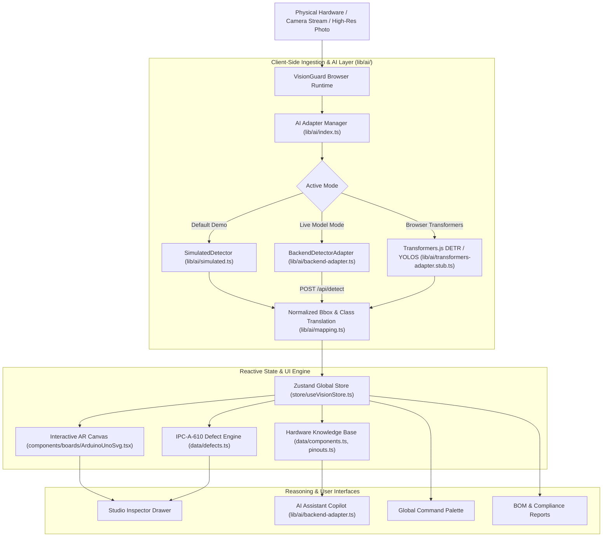

# VisionGuard – AI & AR-Powered Hardware Inspection and Diagnostics

[](https://opensource.org/licenses/MIT)
[](https://nextjs.org/)
[](https://www.typescriptlang.org/)
[](https://tailwindcss.com/)
[](https://github.com/pmndrs/zustand)
[](https://fastapi.tiangolo.com)

> **Hackathon Track:** *Computer Vision, Edge AI & Hardware Security*  
> **Team:** *Access Denied*  
> **Vision:** Empowering engineers, technicians, and hardware enthusiasts to inspect, assemble, and troubleshoot complex PCBs and circuits in real time with augmented reality overlays and edge-native intelligence.

---

## 1. Problem Statement

Engineers, hardware developers, and technicians struggle with:
1. **Manual Inspection Fatigue:** Identifying tiny surface-mount components (0805, 0603, QFN), reading microscopic laser markings, and spotting cold joints or solder bridges with bare eyes is slow, tiring, and prone to severe oversights.
2. **Datasheet Context Switching:** Constantly switching back and forth between physical PCBs and 400-page PDF datasheets to cross-reference pin numbers, timer registers, and voltage limits breaks engineering flow.
3. **Catastrophic Power-On Smoke:** Connecting an unregulated power supply to the wrong header pin or energizing a board with an undetected solder bridge across power rails destroys expensive microcontrollers, regulators, and host PC USB controllers.
4. **Tooling Inaccessibility:** Industrial automated optical inspection (AOI) machines cost upwards of $50,000, leaving students, makerspaces, and rapid prototyping labs without reliable quality control tools.

**VisionGuard solves this by bringing AI and AR-powered visual hardware inspection directly into any standard web browser or mobile phone—with both zero-backend simulation and live FastAPI + PyTorch computer vision inference.**

---

## 2. Key Features

- **Multi-Board Vector Inspection Studio:** High-definition interactive top-down illustrations of **Arduino Uno R3** (25+ detections), **Arduino Uno R3 Defect Variant B**, and **ESP32 DevKit V1** with interactive AR bounding boxes, coordinates, and pins.
- **IPC-A-610 Automated Defect Locator:** Real-time flagging of critical hardware hazards:
  - Solder bridges across 2.54mm header pins (e.g., ICSP VCC to MISO short).
  - Reversed-polarity electrolytic capacitors (C1 cathode reversal).
  - Thermal PCB laminate scorch marks near linear voltage regulators.
  - Missing unpopulated SMT decoupling capacitors.
  - Deflected / bent connector header pins.
- **Pinout & Hardware Bus Matrix:** Exact pinout maps documenting hardware PWM frequencies, ADC resolutions, I2C/SPI bus routes, and current thresholds (20mA recommended, 40mA absolute max for ATmega328P).
- **Component Knowledge Hub:** Authenticated specifications, electrical ratings, failure modes, and manufacturer part numbers for 25+ real components.
- **Hardware Copilot AI Assistant:** Streaming conversational troubleshooting agent ingesting localized bounding boxes, pinout rules, and defect logs.
- **Global Command Palette (Ctrl+K):** Instant keyboard-driven lookup of components, pinouts, defect checklists, and boards.
- **Industrial AI Design System:** Futuristic dark command center aesthetic with cyan/teal accents, blueprint grid backdrops, custom scan-line animations, and full WCAG AA accessibility from 360px mobile to 4K displays.

---

## 3. System Architecture



---

## 4. Setup & Running Locally

VisionGuard offers both a standalone client-side demo mode and a live FastAPI + PyTorch computer vision inference engine.

### Prerequisites
- Node.js 18.x or 20.x
- Python 3.11+ (for backend inference)
- npm, pnpm, or yarn

### Quick Start (Full-Stack: Frontend + Live CV Backend)
```bash
# 1. Start the Next.js Frontend (Port 3000)
npm install
npm run dev

# 2. In a second terminal, start the FastAPI Backend (Port 8000)
cd backend
python -m venv .venv
# On Windows:
.\.venv\Scripts\activate
# On Linux/macOS:
source .venv/bin/activate

pip install -r requirements.txt
python scripts/download_models.py
uvicorn app.main:app --host 0.0.0.0 --port 8000 --reload
```

Or run both concurrently on Windows using:
```powershell
powershell -ExecutionPolicy Bypass -File scripts/start_dev.ps1
```

- Open [http://localhost:3000](http://localhost:3000) to access the VisionGuard Inspection Studio.
- Open [http://localhost:8000/docs](http://localhost:8000/docs) for the interactive FastAPI Swagger API documentation.

---

## 5. Engineering Transparency: Provenance & Models

VisionGuard strictly adheres to hackathon transparency guidelines and explicitly stamps all detections and defects with their origin:

| Feature Dimension | Mode: Simulated | Mode: Live Backend Model |
| :--- | :--- | :--- |
| **Component Detection** | Deterministic catalog coordinates (`source: "simulated"`). | Live YOLOv8/26 model (`source: "model"`), top-left normalized `{x, y, w, h}` bounding boxes. |
| **Defect Detection** | Pre-injected reference board defects for instant presentation. | OpenCV heuristic solder bridge & thermal stress inspection (`source: "heuristic"`). |
| **AI Assistant** | Offline heuristic hardware rule responses. | Context-grounded SSE streaming with hardware context. |
| **Inference Engine** | Client-side zero latency simulation. | FastAPI + PyTorch on CPU or CUDA GPU (`/api/detect`, `/api/defects`, `/api/analyze`). |

---

## 6. Model Attribution & Licenses

- **YOLO PCB Component Detector**: [ParsaVictor/pcb-component-detection-yolo26](https://huggingface.co/ParsaVictor/pcb-component-detection-yolo26) - MIT License.
- **PCB Segmentation & Datasets**: [SanderGi/PCB-Detection](https://github.com/SanderGi/PCB-Detection) - MIT License.
- **VisionGuard Full-Stack Platform**: Team Access Denied - MIT License.

---

## License
MIT License • Created for the 2026 Hackathon Track "Computer Vision, Edge AI & Hardware Security".
