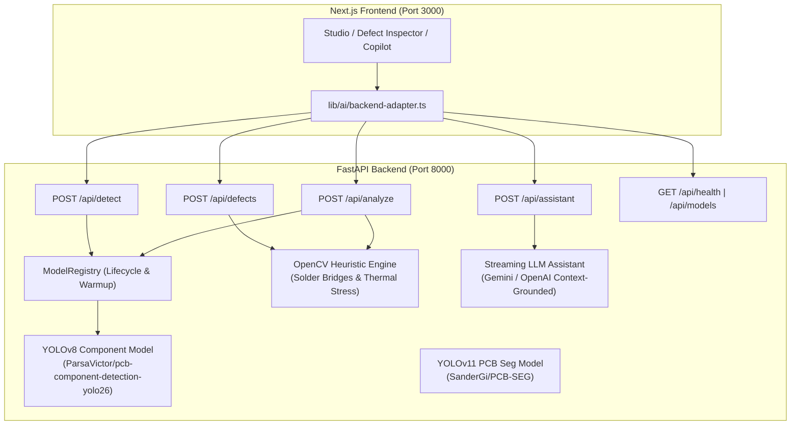

# VisionGuard Computer Vision & Inference Backend

FastAPI and PyTorch backend engine powering VisionGuard's automated PCB component identification, defect detection, and hardware assistant.

---

## Architecture



---

## Features

1. **PCB Component Detection (`POST /api/detect`)**:
   - Runs inference using `ParsaVictor/pcb-component-detection-yolo26` (fine-tuned on real PCB imagery).
   - Detects 13 component classes: `Resistor`, `Capacitor`, `Electrolytic Capacitor`, `IC`, `Inductor`, `Diode`, `LED`, `Transistor`, `Oscillator`, `Connector`, `Switch/Button`, `Other`, `Marker`.
   - Normalizes coordinates strictly to top-left format `{x, y, w, h}` where $0 \le x, y, w, h \le 1$.
   - Enriches raw class names with VisionGuard component metadata, designators, and pin specifications.

2. **IPC-A-610 Heuristic Defect Detection (`POST /api/defects`)**:
   - Classical computer vision engine using OpenCV.
   - Detects solder bridging between adjacent IC/connector pins via adaptive thresholding and morphological closing.
   - Detects thermal stress and substrate scorching using HSV color isolation.
   - All heuristic detections are explicitly stamped with `source: "heuristic"` and IPC-A-610 classification codes.

3. **Unified Board Analysis (`POST /api/analyze`)**:
   - Combines object detection, defect inspection, and board health scoring ($0 - 100\%$) in a single request.

4. **Hardware Copilot Assistant (`POST /api/assistant`)**:
   - Streams Server-Sent Events (SSE) grounded in the board's inspected components and flagged defects.
   - Graceful 503 fallback if API keys are unconfigured.

5. **System Health & Model Introspection (`GET /api/health`, `GET /api/models`)**:
   - Returns model loading status, uptime, hardware device (CPU/CUDA), and class lists.

---

## API Reference

### 1. `POST /api/detect`
Accepts a multipart image upload and returns detected component bounding boxes.

**Parameters (multipart/form-data)**:
- `file`: Image file (`image/png`, `image/jpeg`, `image/webp`).
- `threshold`: Float cutoff confidence (0.05 to 0.95, default `0.25`).
- `mode`: `'fast'`, `'balanced'`, or `'precise'`.
- `board_hint`: Optional board name string for contextual refinement.

**Sample Request**:
```bash
curl -X POST "http://localhost:8000/api/detect" \
  -F "file=@test-assets/sample_arduino_mega.png" \
  -F "threshold=0.25" \
  -F "mode=balanced"
```

### 2. `POST /api/defects`
Evaluates image for soldering and substrate defects.

**Parameters (multipart/form-data)**:
- `file`: Image file.
- `detections_json`: Optional JSON array of known component detections to guide pin inspection.

### 3. `POST /api/analyze`
Executes full detection, defect detection, and computes overall health score.

### 4. `POST /api/assistant`
Streams AI responses grounded in board inspection context.

**Request Body (application/json)**:
```json
{
  "messages": [
    { "id": "1", "role": "user", "content": "What is the function of U2?", "timestamp": "2026-10-31T10:00:00Z" }
  ],
  "context": {
    "boardName": "Arduino Uno R3",
    "detections": [],
    "defects": []
  }
}
```

### 5. `GET /api/health`
```bash
curl http://localhost:8000/api/health
```
```json
{
  "status": "healthy",
  "version": "1.0.0",
  "uptimeSeconds": 142.5,
  "device": "CPU",
  "modelsLoaded": true,
  "models": [
    "ParsaVictor/pcb-component-detection-yolo26",
    "SanderGi/PCB-SEG"
  ]
}
```

---

## Local Development & Setup

### 1. Create Virtual Environment & Install Dependencies
```bash
cd backend
python -m venv .venv
# Windows:
.\.venv\Scripts\activate
# Linux/macOS:
source .venv/bin/activate

pip install -r requirements.txt
```

### 2. Download Model Weights
```bash
python scripts/download_models.py
```
This fetches `fine_best.pt` (20.3 MB) from Hugging Face and places it in `backend/models/`.

### 3. Run FastAPI Server
```bash
uvicorn app.main:app --host 0.0.0.0 --port 8000 --reload
```
Interactive Swagger docs: `http://localhost:8000/docs`

### 4. Run Pytest Suite
```bash
pytest -v
```
All 19 contract tests, unit tests, and integration tests run in under 5 seconds.

### 5. Run Evaluation Script on Real PCB Images
```bash
python scripts/evaluate.py
```
Runs inference across test boards in `test-assets/` and writes annotated verification images to `test-assets/out/`.

---

## Attribution & Licenses

- **YOLO Component Detection Model**: [ParsaVictor/pcb-component-detection-yolo26](https://huggingface.co/ParsaVictor/pcb-component-detection-yolo26) - MIT License.
- **PCB Segmentation Model & Test Datasets**: [SanderGi/PCB-Detection](https://github.com/SanderGi/PCB-Detection) - MIT License.
- **VisionGuard Frontend & Backend Architecture**: Team Access Denied - MIT License.
