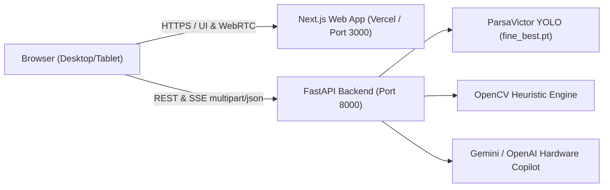

# VisionGuard Deployment Guide

This document details production deployment strategies for the **VisionGuard** platform, comprising the Next.js frontend and the FastAPI + PyTorch computer vision backend.

---

## Architecture Overview



---

## 1. Deploying the Backend with Docker

The backend includes a production-ready `backend/Dockerfile` based on `python:3.11-slim` with OpenCV system libraries pre-configured.

### Build the Image
```bash
cd backend
docker build -t visionguard-backend:latest .
```

### Run the Container
```bash
docker run -d \
  -p 8000:8000 \
  -e CORS_ORIGINS='["https://your-domain.vercel.app"]' \
  -e DEVICE=cpu \
  -e RATE_LIMIT_PER_MINUTE=60 \
  --name visionguard-backend \
  visionguard-backend:latest
```

---

## 2. Cloud Platform Deployments

### A. Railway
1. Fork or push this repository to GitHub.
2. In Railway, click **New Project** -> **Deploy from GitHub repo**.
3. Set the **Root Directory** to `backend`.
4. Add Environment Variables:
   - `PORT`: `8000`
   - `CORS_ORIGINS`: `["https://your-frontend-app.vercel.app"]`
   - `DEVICE`: `cpu`
   - `GEMINI_API_KEY`: *(optional, for assistant streaming)*
5. Railway detects the `backend/Dockerfile` and automatically provisions the container.

### B. Render
1. Create a **New Web Service** connected to your repository.
2. Configuration:
   - **Environment**: `Docker`
   - **Root Directory**: `backend`
   - **Instance Type**: Starter (1 vCPU, 2GB RAM minimum for PyTorch CPU inference)
3. Set Environment Variables:
   - `PORT`: `8000`
   - `CORS_ORIGINS`: `["https://your-frontend.vercel.app"]`
4. Health check endpoint: `/api/health`.

### C. Fly.io
1. In `backend/`, initialize fly configuration:
   ```bash
   fly launch --dockerfile Dockerfile
   ```
2. Allocate at least 2GB RAM for PyTorch model weights:
   ```bash
   fly scale memory 2048
   ```
3. Deploy:
   ```bash
   fly deploy
   ```

### D. Hugging Face Spaces (Docker)
1. Create a new Space with the **Docker** SDK.
2. In your space repository, copy the contents of `backend/`.
3. Set Port to `7860` in `.env` / `app/config.py` (or set `PORT=7860`).
4. Hugging Face Spaces provides free 2 vCPU / 16GB RAM for CPU inference, or optional T4/A10G GPU tiers.

---

## 3. CPU Inference Optimizations & Memory Notes

- **Model Footprint**: The fine-tuned YOLO model (`fine_best.pt`) is ~20.3 MB and consumes ~380 MB RAM when loaded into PyTorch.
- **Thread Count**: On multi-core CPU servers, limit PyTorch worker threads to avoid core contention:
  ```bash
  export OMP_NUM_THREADS=2
  export MKL_NUM_THREADS=2
  ```
- **Inference Latency**:
  - CPU (Intel Core / AMD Ryzen / Modern Cloud vCPU): ~150ms - 240ms per 1024x1024 frame.
  - CUDA GPU (T4 / RTX 3060+): ~18ms - 35ms per frame.

---

## 4. Frontend Configuration

When deploying the Next.js frontend (e.g. on Vercel):
1. In the Vercel dashboard, add the environment variable:
   ```
   NEXT_PUBLIC_API_URL=https://your-backend-api-domain.com
   ```
2. Deploy the frontend.
3. The frontend adapter (`lib/ai/backend-adapter.ts`) will automatically direct component detection, defect inspection, and assistant calls to the live production backend.
